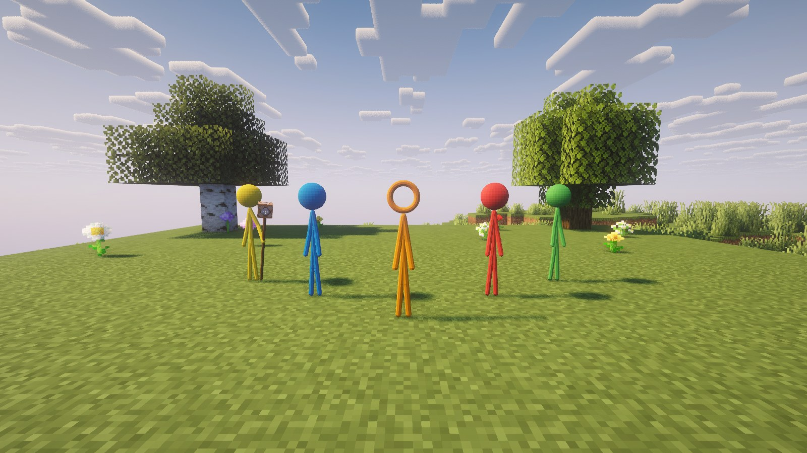
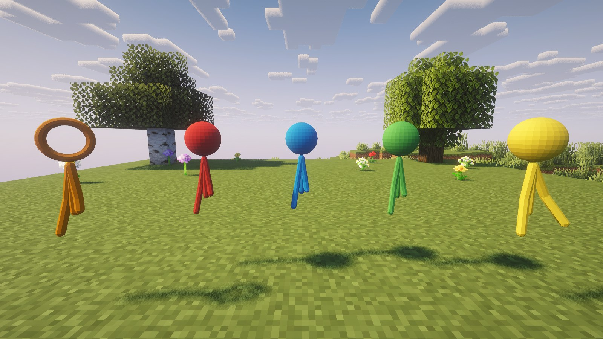
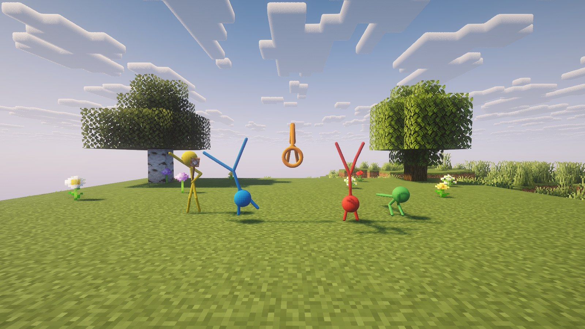
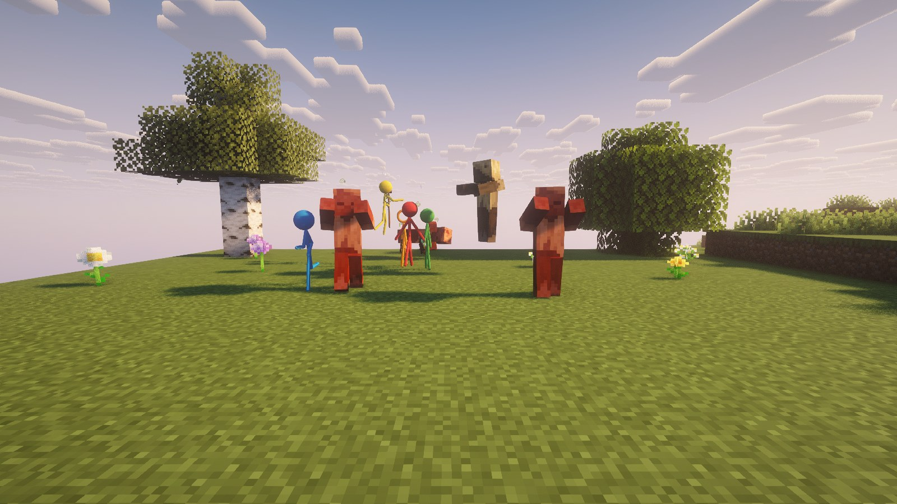
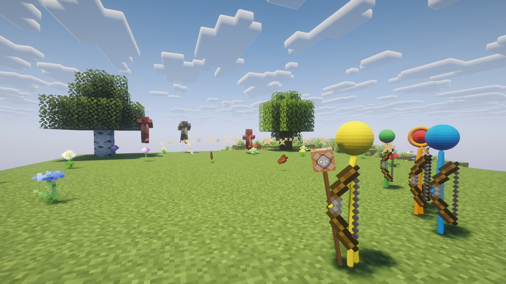
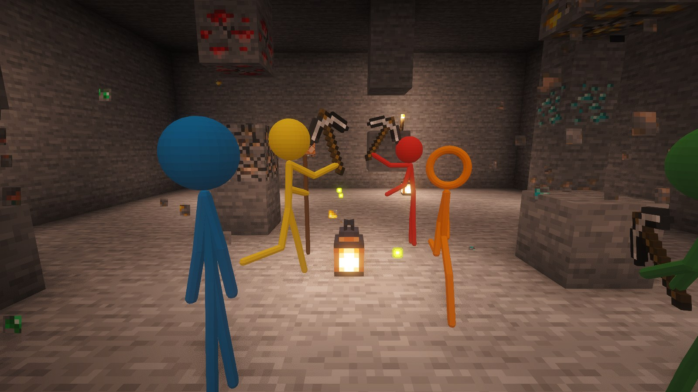
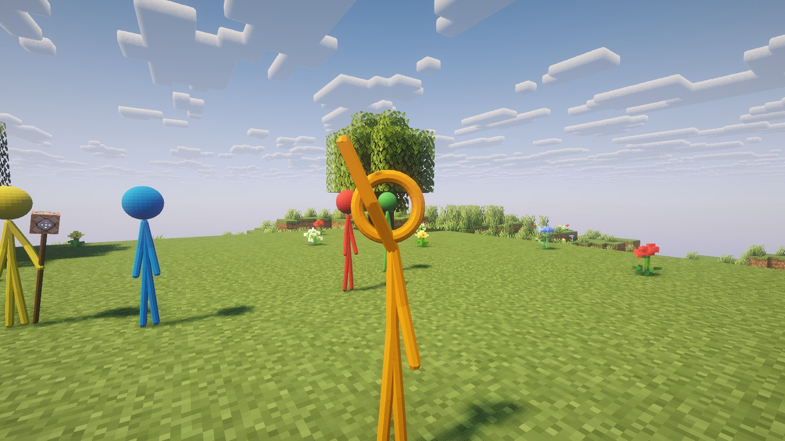
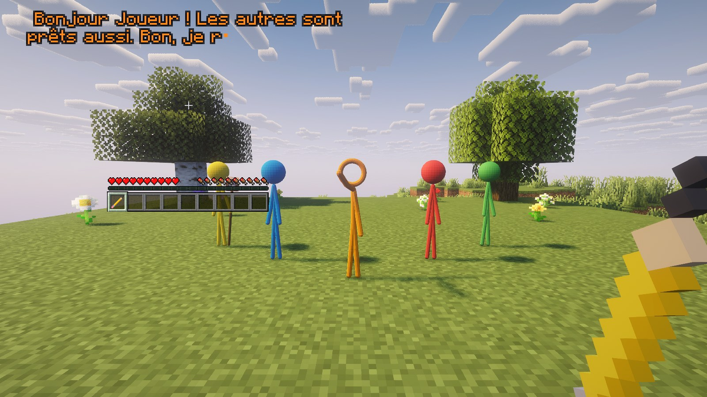
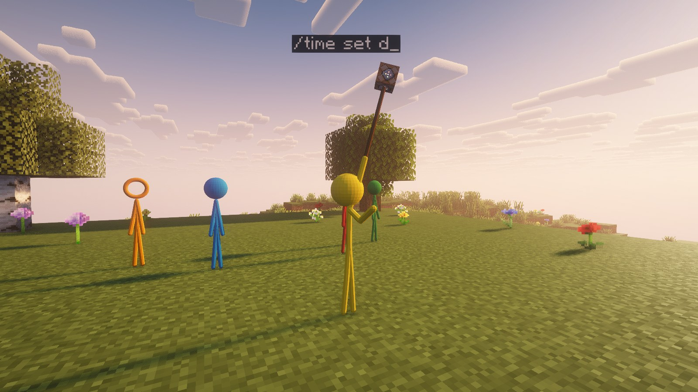
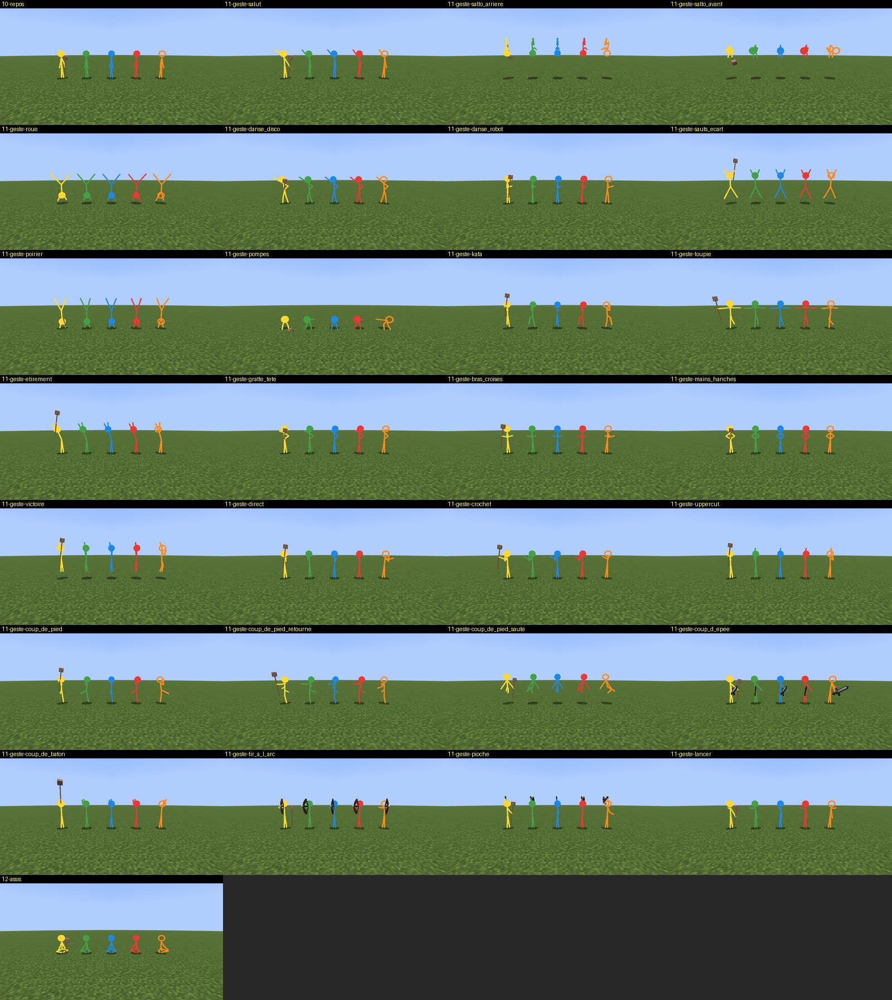

# Alan Becker Stickmen

Orange, Rouge, Bleu, Vert et Jaune, les bonshommes-bâtons des animations d'Alan Becker, débarquent
dans Minecraft : ils te suivent partout, font des acrobaties, se battent contre les monstres et
minent pour toi. Orange a la **tête creuse** et t'**écrit des messages sur l'écran** ; comme dans
la série, Jaune a son **bâton surmonté d'un bloc de commande**.

Minecraft **Fabric 26.3** · Fabric API · Java 25 · projet de fan non officiel



*(Photos prises dans le jeu avec le pack de shaders Complementary Reimagined.)*

---

## Installation

1. Mets `abstickmen-26.3-1.2.0.jar` (onglet **Releases**) et **Fabric API** dans le dossier `mods`.
2. Lance le jeu en Fabric 26.3. Avec Iris et un pack de shaders, les stickmen sont dessinés en relief ;
   sans shaders, ce sont des traits plats, comme dans les animations.

## Dans le jeu

| Action | Effet |
|---|---|
| Clic droit avec le **crayon d'animateur** | il dessine devant toi les stickmen qui manquent, trait après trait (ceux qui sont loin reviennent) |
| **Accroupi** + clic droit avec le crayon | coup de gomme : toute ta bande s'efface |
| Clic droit sur un stickman | une acrobatie ; sur Orange : il t'écrit un message |
| **Accroupi** + clic droit sur un stickman | il reste ici, ou il recommence à te suivre |
| Le regarder droit dans la tête | il te fait coucou |

Le crayon est dans l'onglet créatif **Outils et utilitaires** et se fabrique, dans n'importe quel
ordre, avec un **bâton**, du **charbon** (ou du charbon de bois) et du **papier**. Chaque stickman a
aussi son œuf d'apparition.



### Ce qu'ils font

- **Ils te suivent** en formation derrière toi. Trop loin, ils te rejoignent d'une perle de l'End ;
  ils te suivent aussi dans le Nether et dans l'End.
- **Ils se battent** contre les monstres qui s'approchent de toi, qui te frappent ou que tu frappes :
  Rouge aux poings, Bleu aux pieds (coups de pied sautés et retournés), Vert à l'épée, Orange à la
  hache, Jaune au bâton.
- **Ils tirent à l'arc** sur les monstres qui arrivent de loin (jusqu'à 28 blocs), creepers compris :
  ils s'arrêtent, bandent l'arc et visent en tenant compte de la chute de la flèche et de la marche du
  monstre. Leurs flèches traversent le joueur, les stickmen, les animaux et les villageois. Quand le
  monstre arrive à moins de 5 blocs, ils passent au corps à corps ; un creeper arrivé à moins de 4
  blocs, ils le laissent à Jaune et à ses commandes. Jaune plante son bâton dans le sol le temps de tirer.
- **Ils minent** les minerais visibles autour de toi avec une pioche en fer, puis te rapportent et
  te lancent le butin.
- **Ils font des acrobaties** quand tout est calme : salto avant et arrière, roue, poirier, pompes,
  kata de karaté, danse disco, danse du robot, toupie, sauts écartés…
- Ils guérissent tout seuls et ne craignent pas les chutes. Si l'un d'eux est battu, il suffit de le
  redessiner.









## Orange

**Sa tête est creuse** et toujours tournée vers toi, sous tous les angles.



**Il t'écrit des messages sur l'écran** avec son doigt, lettre après lettre, au-dessus de lui : quand
il arrive, quand tu cliques sur lui, après une victoire, à la tombée de la nuit, quand tu es en
danger, quand la bande trouve des diamants, et de temps en temps. Chaque phrase est composée sur le
moment à partir de ce qui se passe, dans ta langue (français ou anglais), et **n'est jamais écrite
deux fois**.



## Jaune et son bâton de commande

Comme dans la série, **Jaune a un bâton surmonté d'un bloc de commande**. Si les commandes sont
activées pour toi (monde avec la triche activée, ou opérateur sur un serveur), il lève son bâton et
tape une commande quand ça sert. Elle s'écrit en l'air au-dessus de lui, puis apparaît dans ton chat.
Il se bat aussi avec son bâton, et le plante dans le sol quand il tire à l'arc.

| Quand | Ce qu'il tape |
|---|---|
| tu tombes de haut | `/effect give <toi> slow_falling 5 0` |
| tu brûles, ou tu es dans la lave | `/effect give <toi> fire_resistance 30 0` |
| tu te noies | `/effect give <toi> water_breathing 45 0` |
| il te reste 4 cœurs | `/effect give <toi> regeneration 10 1` |
| un creeper approche | `/effect give @e[type=creeper,distance=..14] levitation 4 1` |
| au moins 3 morts-vivants t'attaquent | `/effect give @e[type=#undead,distance=..16] instant_health 1 1` |
| il fait nuit dehors et des monstres arrivent | `/time set day` |
| il y a de l'orage | `/weather clear` |
| tu as faim | `/effect give <toi> saturation 1 0` |
| tu es au fond d'une grotte, dans le noir | `/give <toi> torch 16`, puis la vision nocturne |
| tu mines beaucoup | `/effect give <toi> haste 60 1` |



## Réglages

`config/abstickmen.json` (créé au premier lancement) : `commandes`, `ecrire`, `messagesSpontanes`,
`miner`, `acrobaties`, `arc`. Tout est activé par défaut. Les phrases déjà écrites sont notées dans
`config/abstickmen/phrases-ecrites.txt`.

## Tous les mouvements



*(Captures du test automatique, sans shaders : sur chaque image, les cinq font le même mouvement.)*

---

## Crédits et licence

- Code, textures et icône : licence **MIT** (voir `LICENSE`). Les stickmen sont dessinés par le code :
  aucune image d'Alan Becker n'est utilisée.
- Projet de fan non officiel, sans lien avec Alan Becker ni Alan Becker Inc. Les personnages
  d'*Animation vs. Minecraft* appartiennent à leur auteur.
- Minecraft appartient à Mojang et Microsoft. Projet non officiel, non approuvé par Mojang.

## Pour les développeurs

```
./gradlew build                  compile (et copie le jar dans l'instance CurseForge de test de l'auteur, si elle existe et que le jeu est fermé)
./gradlew runClientGameTest      dessine la bande dans un vrai jeu et prend des captures : mouvements, combat, minage, commande, message
sh outils/tester-dans-instance.sh "<instance>" [photos]   le même test (ou les photos de ce README) dans le vrai jeu d'une instance CurseForge, sans rien y laisser
```

Captures : `run/gametest/screenshots` et `run/instance/captures`. Les textures (crayon, œufs, icône)
sont dessinées par `outils/textures.py`.

---

## In English

Orange, Red, Blue, Green and Yellow, the stick figures from Alan Becker's animations, come to
Minecraft (Fabric 26.3). They follow you, do flips and dances, fight monsters, shoot arrows at the ones
coming from afar (creepers included; their arrows go through you and your pets) and mine ores for you.
Orange has a hollow head that always faces you and writes messages on your screen, a new one every
time. Like in the show, Yellow has the command staff: he uses it when commands are enabled (slow
falling when you fall, fire resistance in lava, `/time set day` when monsters come at night…). Craft the **Animator's Pencil** (stick,
coal and paper) and right-click to draw them; sneak and right-click to erase them. With Iris shaders
they are drawn in 3D, otherwise as flat strokes. Unofficial fan project, not affiliated with Alan Becker.
